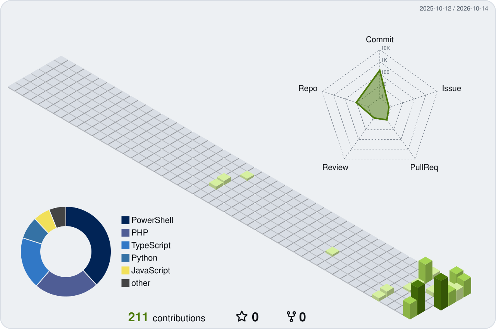

<!--
  README này được sinh tự động từ profile.yml (scripts/build.mjs).
  Muốn đổi nội dung thì sửa profile.yml, xem HUONG-DAN.md. Sửa trực tiếp tệp này sẽ bị ghi đè.
-->

&nbsp;
&nbsp;
&nbsp;
&nbsp;

Hi, I'm Wyatt, a fullstack developer from Ho Chi Minh City, Vietnam. I build web apps on Laravel and Cloudflare Workers, Windows tools in PowerShell and C#, and Python utilities for OCR, data recovery and network security.

&nbsp;

<b>More projects</b>

| Project | What it is |
| --- | --- |
| [Web Brute Force Detection](https://github.com/NovWyatt/web-brute-force-detection) | Flask login that locks IPs and usernames after repeated failures, with an admin dashboard. |
| [IP Checker](https://github.com/NovWyatt/IP-Checker) | Single-page tool that shows your public IP and its details. [Live demo](https://ip-checker-phi.vercel.app) |
| [Weather Dashboard](https://github.com/NovWyatt/WratherMap) | Forecast dashboard on the OpenWeatherMap API with Chart.js. [Live demo](https://wrather-map.vercel.app) |

If you put in the effort, success will surely come to you one day soon.

